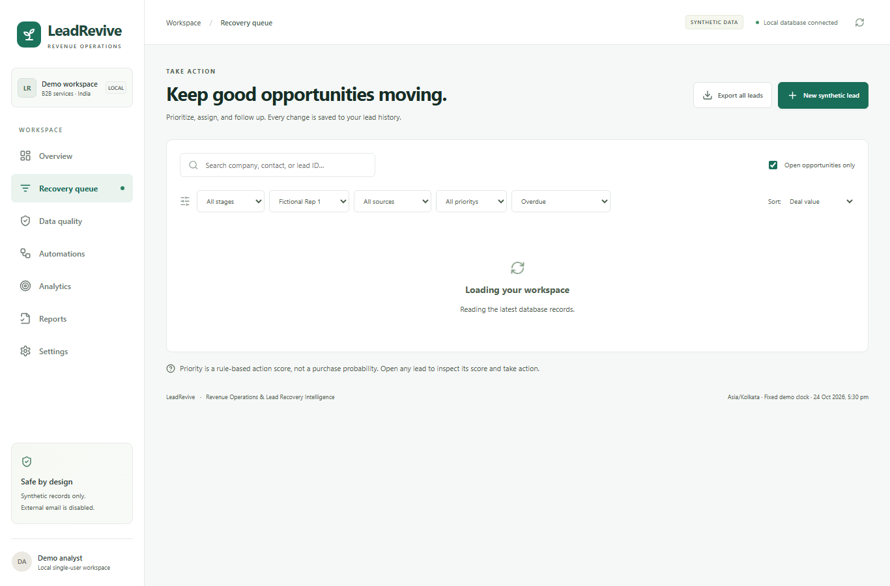
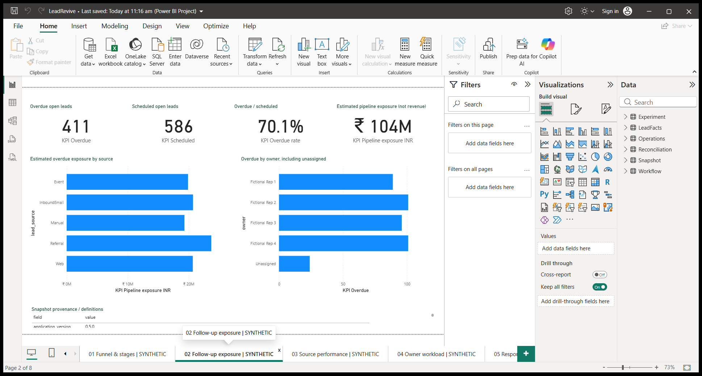

# LeadRevive

[Repository](https://github.com/shivamkr27/leadrevive-revenue-operations-analytics) | [MIT license](LICENSE) | [Third-party notices](THIRD_PARTY_NOTICES.md)

**Revenue Operations & Lead Recovery Intelligence** — a local, synthetic business-operations portfolio project using Python, SQL, Excel, Power BI and n8n.

LeadRevive makes unowned enquiries, response-SLA breaches and missed next actions visible. It combines working lead management, controlled local automation and reproducible management reporting. Estimated pipeline exposure is an opportunity-value sum, **not recovered revenue**. External live delivery and public deployment are disabled.

## Start locally

Windows, Docker Desktop and Python are required. From the workspace root:

```powershell
python -m venv .venv
.venv\Scripts\python.exe -m pip install -r requirements.txt
powershell -ExecutionPolicy Bypass -File scripts/start_local.ps1
```

The startup script migrates/seeds an empty PostgreSQL database and builds React. A populated database is preserved without implicit migrations or reseeding; existing n8n workflows retain their publication states. New installations have 754 seed leads; the reviewed 758-record snapshot includes four retained integration fixtures. See [setup and isolated QA](docs/SETUP.md). Do not remove Docker volumes or overwrite PostgreSQL with the historical SQLite bootstrap.

| Local tool | Address |
|---|---|
| LeadRevive operations, Analytics and Reports | http://127.0.0.1:8000 |
| API documentation | http://127.0.0.1:8000/docs |
| n8n | http://127.0.0.1:5678 |
| Mailpit test sink | http://127.0.0.1:8025 |

See [current setup and reporting](docs/SETUP.md) for generation, portable Power BI refresh and validation instructions. Credentials remain in the ignored local `.env`; no external SMTP account is configured.

## Working capabilities

- Normalize/import leads, preserve duplicate history and review identity conflicts.
- Filter and prioritize a recovery queue; persist owners, stages, schedules and contact notes with audit history.
- Run four actual n8n workflows: intake, grouped overdue recovery, approval-controlled outbox and status sync.
- Test SMTP acceptance through Mailpit with explicit preview approval, bounded retry, cooldown and duplicate-send safeguards.
- Analyze stages, sources, owner workload, elapsed-hour SLA and estimated exposure in React, Excel and editable Power BI.
- Generate snapshot-consistent Word, PDF, 10-slide PowerPoint and case-study reports on demand, including empty creation cohorts.

## Analysis and evidence

The generator produces 800 raw rows: 754 accepted seed leads, 32 invalid rows, seven duplicates and seven conflicts. Four retained integration fixtures bring the reviewed cohort to **758 synthetic records**. This is not customer growth. The approved Phase 4 snapshot remains preserved; live operation values can change with time.

Thirteen KPIs reconcile through independent PostgreSQL/application calculations, fact aggregation, CSV/Excel readback and actual Desktop DAX checks. React Analytics consumes a frozen snapshot; it is not a separate domain calculation. Immutable generations prevent mixed-file refreshes and pin report provenance.

The controlled 40-event comparison produces **20 versus 34 modeled contacts** under different review schedules and the same assumed owner response. It does not prove real conversion improvement, human savings or recovered revenue. Local SMTP results mean **SMTP accepted by local sink**; external live delivery disabled.

| Artifact | Location |
|---|---|
| SQL queries and KPI definitions | [SQL pack](analytics/sql/README.md), [metrics dictionary](docs/METRICS_DICTIONARY.md) |
| Preserved Phase 4 Power BI | [PBIX](analytics/powerbi/LeadRevive_Phase4_SYNTHETIC.pbix) |
| Phase 5 Power BI | [PBIX](analytics/powerbi/LeadRevive_Phase5_SYNTHETIC.pbix), [editable project](analytics/powerbi/phase5/LeadRevive.pbip) |
| Case study and decision brief | [Case study](docs/PHASE_5_CASE_STUDY.md), [business case](docs/BUSINESS_CASE.md) |
| Reviewable Word/PDF/PowerPoint | [Versioned representative deliverables](reports/portfolio/v1.0.0/README.md); Reports page for new generation |
| Architecture and audit | [Architecture](docs/ARCHITECTURE.md), [pre-Phase-5 audit](docs/PRE_PHASE5_AUDIT.md) |
| Test results and current deliverables | [Phase 5 report](docs/PHASE_5_REPORT.md) |
| UAT and demonstration | [UAT](docs/UAT_PHASE_5.md), [demo script](docs/DEMO_SCRIPT.md) |
| Career preparation | [role-specific resume candidates](docs/RESUME_CLAIMS.md), [interview notes](docs/INTERVIEW_NOTES.md) |
| Actual interface evidence | [screenshots index](screenshots/README.md) |

## Verification and boundaries

Focused regressions cover normal/empty export and reporting, interrupted publication, pinned generations, null semantics, stale evidence, tampering and failed render cleanup. Existing phase evidence records real n8n/Mailpit execution and database preservation. Exact execution results are documented by phase; no test count is a production reliability claim.

The system is local and single-user. It has no production user/role model, client deployment, public hosting or external SMTP transport. Implementation was AI-assisted; resume candidates must reflect work the owner can explain and demonstrate. References and reuse boundaries are in [REFERENCES.md](docs/REFERENCES.md).

## Portfolio preview





## Repository map

```text
backend/                 FastAPI, business rules, Alembic migrations, regression tests
frontend/                React operations/analytics/reports UI and browser tests
automation/n8n/          Four editable business workflows and schedule-test fixture
analytics/sql/           Independent KPI and management/evidence queries
analytics/powerbi/       Editable PBIX, PBIP, semantic model and DAX
analytics/exports/       Frozen synthetic CSV/Excel and reviewed immutable generation
data/synthetic/          Reproducible fictional seed CSV and provenance
reports/portfolio/       Versioned representative documents, slides and provenance
reports/templates/       Matching screenshot evidence metadata
scripts/                 Setup, QA, generation, export and release packaging
screenshots/             Actual application, Power BI and local workflow evidence
docs/                    Requirements, architecture, metrics, UAT, case study and career notes
```

Final QA results and remaining limitations: [Phase 6 report](docs/PHASE_6_REPORT.md). Release contents and approval steps: [release checklist](docs/RELEASE_CHECKLIST.md). Exact manual publication commands: [Git publication](docs/GIT_PUBLICATION.md). Attribution: [references](docs/REFERENCES.md), [dependency licenses](docs/THIRD_PARTY_ATTRIBUTION.md). [MIT covers original project material](docs/LICENSING_STATUS.md); third-party components retain their own terms and notices.

**v1.0.0 prepared locally for push approval.** No GitHub push, release publication or deployment has been performed. External sending remains disabled.
