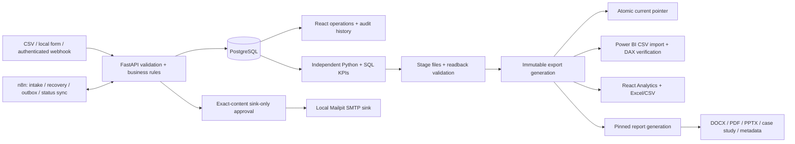

# Architecture — LeadRevive

Local single-user business-operations prototype. All demo data is synthetic. PostgreSQL owns operational records; external live delivery and public deployment are disabled.

## Operational records

SQLAlchemy Core and Alembic migrations 0001–0005 support PostgreSQL with SQLite as a preserved bootstrap/regression path. Integer paise stores monetary estimates. UTC timestamp strings use canonical six-digit precision; business UI uses Asia/Kolkata. Lead versions prevent stale updates; changes retain audit/history events. Import hashes make identical files idempotent; conflicting identities remain reviewable instead of silently merged.

Priority scoring is deterministic and explained. First-response SLA uses elapsed hours. Completing a contact preserves first response and updates last contact but does not reschedule next action automatically. Raw overdue and reminder eligibility therefore differ.

## Automation controls

n8n orchestrates authenticated backend routes. Its own workflow/credential/execution metadata is persisted separately from PostgreSQL business data. PostgreSQL transaction-scoped advisory locking, idempotency keys, unique delivery records, reservations and cooldown coordinate reminders. Stable Message-ID plus Mailpit lookup supports retry/reconciliation. Uncertain acknowledgements without a sink match block blind resend. Three logical send attempts are allowed.

Internal owner notices are automated. Customer previews require explicit exact-content/context/version sink-only approval; lead changes invalidate stale approval. The only implemented transport permits local Mailpit addresses. No external SMTP mode exists. This is tested local duplicate protection, not a universal production exactly-once protocol.

## Analytics publication and provenance

`analytics.py` extracts a creation cohort in one PostgreSQL repeatable-read transaction. SQL and Python calculations independently reconcile; exported fact aggregation and actual CSV/Excel readback are also checked. Empty cohorts retain schemas and null rates/median rather than inventing zero rates.

`exporting.py` writes only to a private staging folder, validates the complete pack, renames it into `analytics/exports/generations/<id>`, then atomically replaces `current.json`. A failed write leaves the old pointer valid. Existing generations remain immutable; no stale files are copied into a new generation. UI downloads pin the generation returned with their snapshot. Legacy Phase 4 root exports remain preserved.

`snapshot_id` identifies the source data snapshot. `data_revision` additionally binds cohort metadata, experiment content and code/model/exporter provenance. `generation_id` identifies a concrete publication, including validation proof. Adding valid Desktop proof creates a new publication without changing its data/model revision. Hash manifests validate artifacts; these are integrity checks, not cryptographic identity signatures.

Power BI imports one immutable generation path and calculates DAX over derived facts. Desktop verification checks all 13 KPIs with null semantics, snapshot ID, data revision and model hash. It does not imply every reporting surface independently implements domain rules. Current-state snapshots do not reconstruct historical pipeline states.

## On-demand management reports

The Reports UI posts a pinned generation or asks for a fresh PostgreSQL creation cohort. Fresh cohorts are validated and published without changing the main Analytics pointer. The report service verifies source hashes, derives all business statistics from that snapshot, and generates editable Word/PowerPoint, a portable ReportLab PDF and supporting metadata. Reports are staged and published only after generation succeeds. Downloads are allowlisted and hash checked.

Screenshot evidence is included only when data revision and image hashes match. Filtered/empty reports omit mismatched screenshots. Portable PDF and Word share structured content; pixel-identical layout is not claimed. Optional installed-Office previews are separate review artifacts, not required server dependencies.

## Local deployment and limits

Compose runs backend/UI, PostgreSQL, n8n and Mailpit with loopback-bound host ports and persistent volumes. Local `.env` holds generated secrets; no credentials appear in clients, report artifacts or exported workflows. Host/origin checks do not constitute production user authentication. Single-user access, throughput and crash recovery are not production-certified. Phase 6 authorizes local QA and portfolio packaging only; public deployment, GitHub publication and external email remain unapproved.

Fresh-install bootstrap requires an explicit database URL and seeds only an empty database. It skips a populated database without applying migrations. Existing-install schema changes require separate review. Phase 6 QA uses an independent Compose project, ports, volumes, credentials and report/export binds; operational preservation is checked through read-only transactions and original-row hashes.
